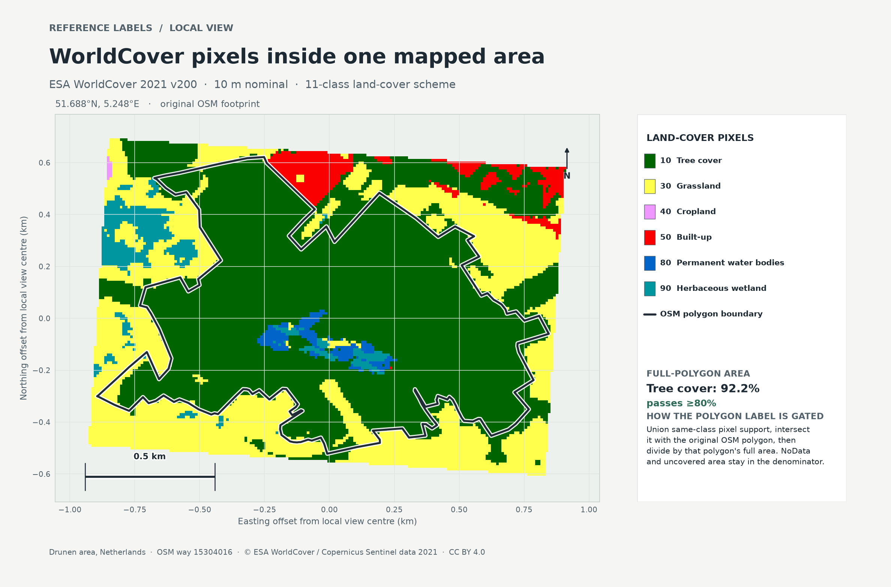

# Reading one WorldCover polygon label

ESA WorldCover 2021 v200 assigns a categorical land-cover class to each nominal
10 m pixel. The class describes the ground at the pixel location; it does not
describe the meaning or use of an OpenStreetMap feature.

The figure uses the repository's bounded Netherlands raster fixture and OSM way
15304016 in Drunen. The production coverage adapter measures the class support
against the **full original OSM polygon**. Tree cover (class 10) occupies
92.2% of that area, so this example passes the inclusive 80% gate. The label
calculation combines support by class before intersecting it with the polygon.
NoData and uncovered area remain in the denominator.



This is a bounded illustration of one local example, not a map of dataset
coverage and not an evaluation result. Rebuild it from the repository fixture
with:

```bash
uv run python scripts/render_worldcover_reference_figure.py
```

The figure shows only classes present in this local raster window. Its colors
are for legibility and follow the WorldCover class codes. The class definitions
and source version are documented in the [ESA WorldCover v200 release](https://doi.org/10.5281/zenodo.7254221). ESA WorldCover 2021 v200 is © ESA
WorldCover project 2021 and contains modified Copernicus Sentinel data (2021),
processed by the ESA WorldCover consortium, under CC BY 4.0. The OSM geometry
is © OpenStreetMap contributors under the Open Database License.
